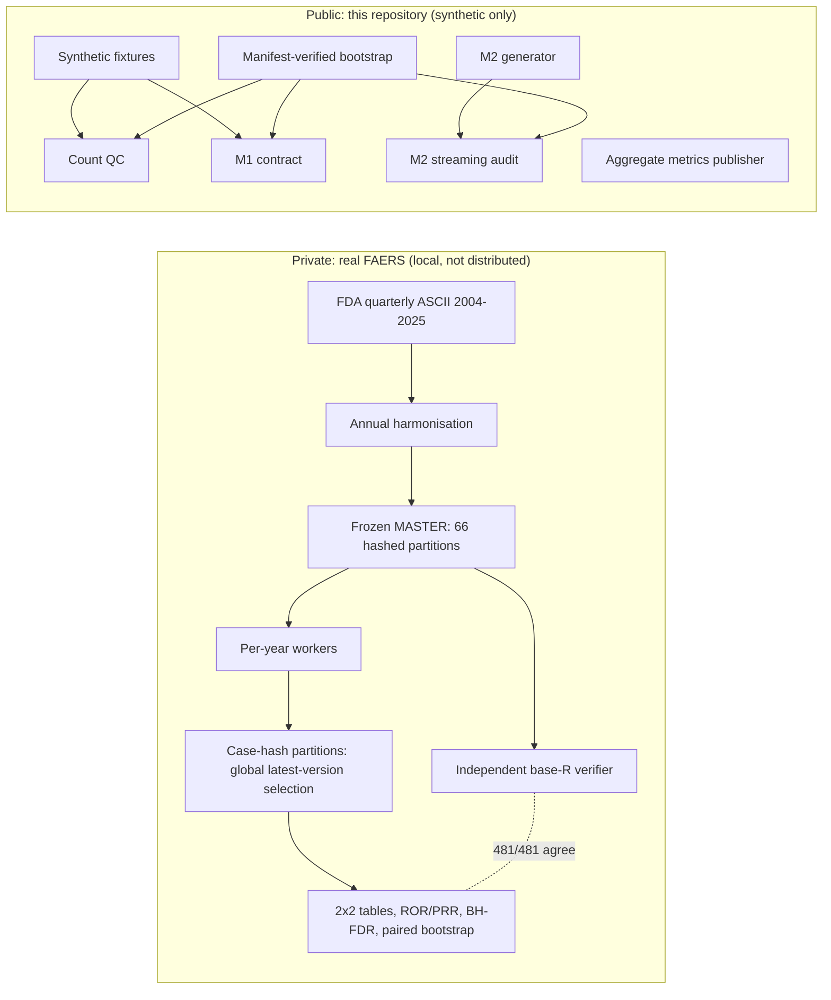

# Renal Safety Atlas

**Clinical data engineering for renal pharmacovigilance — with a public synthetic Python/R validation toolkit.**

Renal Safety Atlas investigates how report identity, follow-up versions, ingredient representation and terminology affect reproducible FAERS research. This repository exposes the tested engineering contracts and documents the scale of the private research pipeline. Clinical interpretation and manuscript publication remain on HOLD.

Author: Ahmed Alaqab آ· Licence: [MIT](LICENSE) آ· Cite: [CITATION.cff](CITATION.cff)

> **What is public here:** tested Python and base-R quality-control software, run on **synthetic data only**.
>
> **What is private:** the real FDA FAERS pipeline. Its scale and verification are documented in [Engineering at scale](docs/ENGINEERING_AT_SCALE.md); no FAERS records are distributed.
>
> **Not provided:** no drug-safety signal, incidence or causal estimate is published or implied.

---

## At a glance

| Question | Answer |
|---|---|
| **Problem** | FAERS disproportionality analyses are routinely distorted by duplicate follow-up versions, deleted cases, inconsistent drug identities, changing MedDRA terminology and multiple-testing shortcuts |
| **Real-scale work (private)** | 22 years (2004–2025); 66 frozen, hash-verified partitions; **197,651,666 table rows**; [sanitized annual evidence](docs/SCALE_EVIDENCE.csv) |
| **Engineering implemented** | Global case-version selection; FDA deleted-case lists; drug ingredient and salt harmonisation; renal terminology era effects; bounded-memory, restartable execution; explicit pilot BH-FDR families; integer-overflow and bootstrap-failure defects |
| **Independently verified** | Population counts, contingency tables, ROR/PRR/CI, FDR and bootstrap: **481/481 checks** between two independent implementations on real data |
| **Provisional** | Clinical endpoint definitions, salt policy, deleted-case policy, drug-mapping accuracy review. All are pending human decisions |
| **Public, runnable code** | Synthetic count QC, sufficient-statistics contract (M1), streaming diagnostics (M2), an aggregate-metrics publisher, one bootstrap command |
| **Research questions** | See the [research roadmap](docs/RESEARCH_ROADMAP.md) (flagship: report- vs case-level selection) |

## Architecture



More detail: [architecture](docs/ARCHITECTURE.md) آ· [methodology](docs/METHODOLOGY.md) آ· [limitations](docs/LIMITATIONS.md) آ· [project profile](docs/CLINICAL_DATA_SCIENCE_PROJECT_PROFILE.md).

## Quick start (synthetic)

Requirements: Python 3.12 (or locally checked 3.14.7, standard library only) and R 4.6.1 (base only). No package installation is needed.

```text
python -I tools/ci_bootstrap.py --output <new-dir-outside-repo> --work-dir <existing-dir> --rscript Rscript
```

- Exit code 0 means every suite passed.
- On Windows the work directory must not contain spaces.
- Individual demos:
  - `python -I run_demo.py --output <new-dir> --rscript Rscript` (count QC);
  - `python -I run_m1_demo.py --output <new-dir> --work-dir <dir> --rscript Rscript` (M1);
  - `modules/m2/m2_cli.py` (M2; see the [module README](modules/m2/README.md)).

## Quality control in this repository

| Suite | Content |
|---|---|
| Count QC | 13 + 90 Python tests, 89 R cases, 36 runner tests, 8 CI guards; numeric output and repeated-hash checks |
| M1 sufficient statistics | 65 shared cases per language, 31 language-native cases, 186 exact Python/R parity comparisons |
| M2 streaming | 31 tests including 19 adversarial schema sub-cases |
| Integration | Python/R coexistence, cross-module and repeated-demo hash checks |
| Release integrity | Every file listed with size and SHA-256 in [`RELEASE_MANIFEST.csv`](RELEASE_MANIFEST.csv); `.gitattributes` keeps bytes identical across platforms |

These counts describe test coverage. They are not a scientific validation score.

**Verified locally:** Windows 11 (Python 3.14.7, R 4.6.1) passes the full bootstrap. A fresh checkout passes with `core.autocrlf` set to true, false and input.

**Checkout integrity:** use a fresh clone if switching from a historical branch causes a manifest mismatch. Preserve local work. See [reproducibility](docs/REPRODUCIBILITY.md).

**Hosted CI:** Hosted validation recorded on 2026-11-10 for `b0d74de83a3212338a39222d4ec6df833b8f8a88`: [full Windows/Ubuntu synthetic suite](https://github.com/ahmedalaqab33-source/RENAL_FAERS_2026/actions/runs/42806006151) and [aggregate metrics tests](https://github.com/ahmedalaqab33-source/RENAL_FAERS_2026/actions/runs/42806005650) passed. Logs confirm zero failures, R 4.6.1, Python 3.12.10 (Windows) / 3.12.16 (Ubuntu), and all ten metrics tests. Later changes require their own exact-head checks; see [draft PR #3](https://github.com/ahmedalaqab33-source/RENAL_FAERS_2026/pull/3).

## Research competencies demonstrated (with where the evidence is)
- **Clinical big-data engineering:** partitioned, checkpointed, memory-bounded processing of about 198 M rows on a 16 GB workstation ([evidence](docs/ENGINEERING_AT_SCALE.md)).
- **Pharmacovigilance methodology:** report vs case units, deleted cases, drug identity, MedDRA era effects ([methodology](docs/METHODOLOGY.md)).
- **Statistical quality assurance:** an exact 2أ—2 invariant, pre-specified BH families, transparent bootstrap failures, an independent re-implementation.
- **Reproducible research software:** a manifest-verified release, cross-language parity, deterministic outputs.

Not demonstrated or claimed: supervised machine learning, prediction, causal inference, clinical deployment.

## Limitations
- FAERS is a spontaneous reporting system: under-reporting, stimulated reporting and missing fields.
- Disproportionality measures **reporting associations**, not risk.
- Clinical endpoint and policy decisions are on HOLD.

See [limitations](docs/LIMITATIONS.md).

## Rights and citation
- Ahmed Alaqab confirmed ownership and licensing authority for this software, and attested on 2026-11-08 that public visibility of the repository was authorised.
- Software rights do not grant redistribution of FAERS-derived, MedDRA, RxNorm or other reference data.
- Citation version 0.1.0; no release tag or DOI is asserted.

## Repository guide

[Capabilities](docs/VALIDATED_CAPABILITIES.md) آ· [Reproducibility](docs/REPRODUCIBILITY.md) آ· [Engineering case study](docs/ENGINEERING_AT_SCALE.md) آ· [Contributing](CONTRIBUTING.md) آ· [Security](SECURITY.md) آ· [Changelog](CHANGELOG.md)
