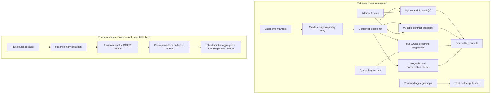

# Architecture and execution boundaries

The historical source-to-MASTER build lacks version-controlled replay. The private pipeline does not feed the public fixtures. Only a manually reviewed, sanitized engineering-scale summary is included in documentation.

Count QC and M1 are separate APIs with different zero-cell contracts. M2 preserves text namespaces and physical occurrences; it does not infer clinical entities. The dispatcher tests all modules and checks source immutability. The bootstrap rejects unlisted files and copies no Git metadata.

Source navigation: [count implementation](../tools/release_qc.py), [R count implementation](../R/count_qc.R), [M1 contract](M1_CONTRACT.md), [M2](../modules/m2/README.md), [metrics publisher](../tools/build_project_metrics.py), [test dispatcher](../tools/run_all.py).

The synthetic workflow runs manually and on pull requests, is read-only, action-pinned and uploads no artifacts. The metrics workflow tests pull-request changes. Hosted execution and local test results are separate evidence classes.
