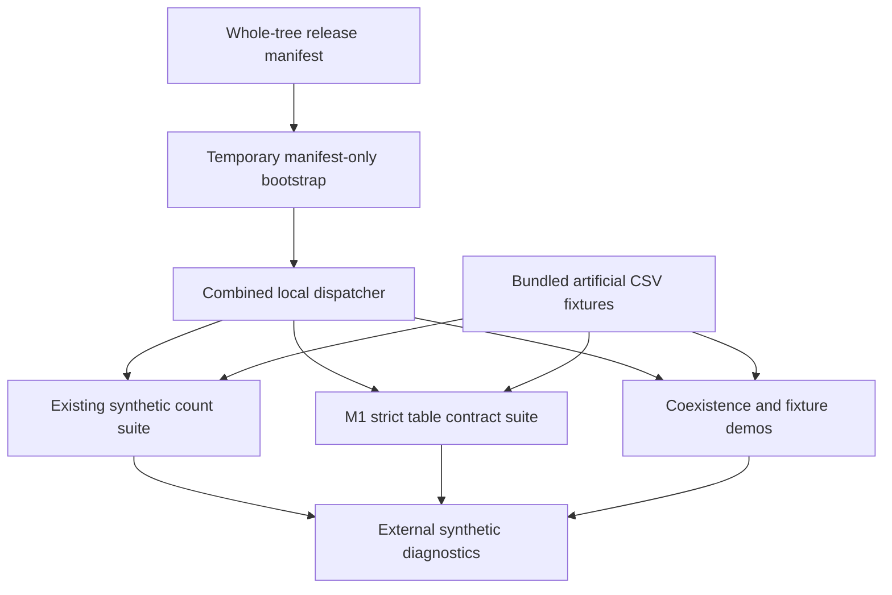

# Executable architecture and maturity

Count functions and M1 validators are separate pure APIs. Fixture adapters alone read the named bundled examples; test coordinators alone write designated external diagnostics. The bootstrap checks exact membership and hashes, excludes top-level Git metadata only, rejects unlisted content and copies no credentials. No actual Git commands are part of execution.

`tools/run_ci.py` remains the existing count suite. New `tools/run_all.py` runs it, then the byte-identical M1 suite and new integration suite. `tools/ci_bootstrap.py` changes only its dispatch target. The workflow policy is unchanged: manual-only, least privilege, pinned actions, no secret inputs or artifact upload. Hosted execution remains unverified.

The broader Atlas source-processing/report-universe/drug-identity/phenotype/scientific pipeline is not included. Scientific lineage, ethics, privacy, terminology and independent-review restrictions cannot be closed by the diagram or synthetic tests. There is no patient-level prediction or causal inference path in this executable tree.
