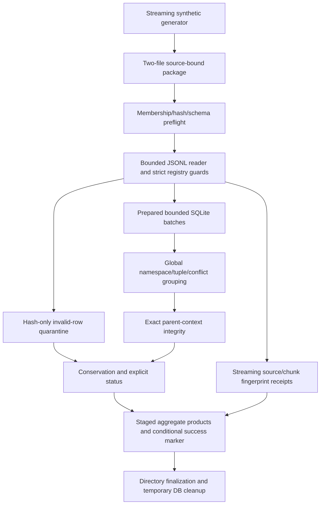

# Implemented flow

No real FAERS data, terminology, API, network client or historical database is an input path. The pipeline creates a new transient SQLite database; it does not open an original MASTER/index. Indexes and global grouping are disk-backed where appropriate; SQLite temporary grouping memory is capped separately. Test-only independent Python grouping materializes only tiny artificial cases, not the pipeline population.

Output reservation uses an exclusive cooperative sibling lock. Products are written in a sibling staging directory, metadata JSON is flushed/fsynced, then renamed on the same filesystem. Clean runs alone contain `_SUCCESS`. This is not a power-loss transaction across filesystem/DB and not protection against a hostile concurrent process ignoring the lock. See LIMITATIONS.md.
